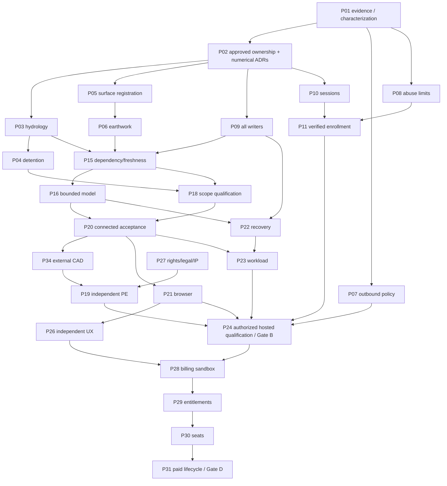

# CIVORA MASTER REMEDIATION PLAN

Planning date: 2026-10-15. Repository: `/Users/tommychoe/Documents/Playground/Civora AI`.
Audit/current application baseline: `ab7db888e85fb9b6125551ecff769d08e0ca7322`.
**PROPOSED PROGRAM ONLY. No repairs, tests, installations, migrations, deployment or commits authorized by this document.**

## 1. Executive decision

Pursue incremental remediation, not a rewrite. Preserve canonical v1, saved designs, user geometry/IDs, correct calculations, edit/calculation/review history, provenance, AI/GIS contracts, supported imports/exports and collaboration. There is no evidence targeted remediation is infeasible. Do not confuse an incrementally improved aggregate with a universally verified computational kernel.

The October 15 user-supplied audit classified functional alpha (Stage 4). Current HEAD equals the audit revision; empty Git comparison shows no intervening code changes. Static reinspection confirms original engineering/control gaps. No findings are “already fixed” on new source. Some paths already have safeguards: `project_snapshot.save_project_snapshot` supplies revision/result tokens; do not replace working protection. The chat direct full-record save remains a risk. No tests were rerun in this planning assignment; the audit's 24 checks are historical transcript evidence.

Counted portfolio: **51 unique issues**, 36 parent packages. **11 confirmed technical defects/vulnerabilities** (6 defects, 5 vulnerabilities), 9 credible risks, 23 evidence gaps, 2 architectural improvements, 2 usability improvements, 3 commercial requirements, 1 missing native-format implementation. SEC-10 aliases CAN-03 and is not double-counted. All remain OPEN. The 32 risk/evidence items are not 32 confirmed bugs. No live exploit, customer-data inspection or production correctness claim is made.

## 2. Documents and authority

1. [Issue register](CIVORA_ISSUE_REGISTER.md): authoritative finding IDs, evidence, classification, original-audit mapping and reconciliation.
2. [Engineering validation](CIVORA_ENGINEERING_VALIDATION_PLAN.md): numerical contracts, all-family qualification, independent oracle and PE requirements.
3. [Security plan](CIVORA_SECURITY_REMEDIATION_PLAN.md): threat boundaries, abuse/identity/session/privacy controls.
4. [Canonical model](CIVORA_CANONICAL_MODEL_PLAN.md): ownership, dependency graph, write concurrency and growth budgets.
5. [Testing and gates](CIVORA_TESTING_AND_RELEASE_GATES.md): 24-case reconstruction, future commands, workloads and release authority.
6. [Backlog](CIVORA_IMPLEMENTATION_BACKLOG.md): every task's scope, sources/root cause (via linked issue), dependencies, effort, alternatives, tests, acceptance, reviewer, risks, rollback, commands and first-ten prompts.
7. [Final re-audit](CIVORA_FINAL_REAUDIT_PROTOCOL.md): frozen-candidate independent closure process.

No old audit is edited by these documents. A plan acceptance is not numerical approval, test execution authorization, professional signoff, legal review or permission to deploy/spend. Conflicts between documents: issue register owns identity/status; domain plans own technical constraints; gate plan owns release decisions; backlog owns work boundaries. Escalate contradictions rather than pick a convenient version.

## 3. Reconciliation and missing evidence

The full October 15 audit was located in the conversation provided by the user, not a standalone committed file. Earlier reports and /tmp artifacts exist. Preserve their original bytes; P01 proposes append-only custody in future authorized work.

Important discrepancy: the browser artifact at its original /tmp path now has 701 testcase nodes, 23 failure children, no error children and 15 skips; audit text described 700,21,1,16. The current SHA is recorded in TEST-08. Unknown whether replaced/reused or otherwise changed; never splice totals to declare green. Backend XML still has 2239 cases with zero failure/error/skip. Historical runtime/advisory scans are not current-candidate acceptance.

Qualify original claims: wrong runoff accessor proves helper defect, not every downstream storm design is zero; no observed credential theft/XSS/metadata compromise; current edge/provider controls unknown. Historical Aug 8 restore exists but is not current full project recovery. Native DWG may remain excluded without blocking honest launch. Open signup default does not prove the deployed setting; local explicit invitation flag is supported.

## 4. Workstreams and accountable roles

| Workstream | Packages | Direct engineer-days | Accountable owner / independent acceptance |
|---|---|---:|---|
| Engineering calculations and AI action safety | P03–P06,P18,P34–P36 | 120–240 | Senior numerical/backend engineer; discipline PE/geospatial/CAD reviewer |
| Canonical model/data integrity and targeted maintainability | P02,P09,P15,P16,P33 | 40–79 | Principal architect/data engineer; independent concurrency review; P33 after characterization, not a rewrite |
| Security/authentication/supply chain | P07,P08,P10–P14,P17 | 38–76 | Application security lead; independent security reviewer |
| Testing/quality assurance | P01,P20; P21 and domain tests cross-cut | 13–25 plus UX row | QA lead; evidence custodian independent of implementer |
| Infrastructure/operations | P22–P25 | 24–48 | Platform/DB engineer; incident/recovery owner |
| UX/onboarding/accessibility | P21,P26 | 12–24 | UX/accessibility specialist; independent civil engineers |
| Commercial subscriptions | P28–P31 | 29–58 | Payments/backend lead; finance/security/product reviewers |
| Legal/IP/release governance | P19,P27,P32 | 18–36 | Founder/release owner; independent PE and licensed counsel |

Total **294–586 engineer-days**, plus 25–40% discovery/integration reserve: approximately **370–820 engineer-days**. Do not add each issue's mapped estimate again. P18 includes benchmark/oracle/test construction and routine qualification, not arbitrary repairs to every newly found solver defect; reserve may prove insufficient if supported scope expands. External PE/legal/security/CAD review labor/fees, recruitment, procurement and waiting are excluded. Parallel people do not turn engineer-days into a reliable calendar forecast.

Illustrative beta subset using P24 dependency closure plus minimum operational/UX/AI/security work is 188–374 engineer-days before reserve when P18 is restricted to a 20–40-day approved narrow qualification slice. This is not a promise or requirement to enable all AI. Disabling unqualified optional AI/learning/imagery/native CAD can reduce scope; document the recalculated graph and estimate rather than secretly skipping safeguards. Full all-family qualification remains in P18.

Roles are proposed, not assigned real people. Founder must appoint named evidence owner, senior implementer, PE(s), security reviewer, release operator and support owner before gate decisions. An AI agent cannot impersonate independent professional approval.

## 5. Dependency sequence and critical path

The backlog lists complete edges; diagram omits some for readability. Gate B also requires scoped security, source privacy, support and recovery evidence even if diagram does not show every edge. P19 depends on P20/P34 qualification, not vice versa: internal benchmark acceptance is not independent human approval. Gate C requires subsequent independent beta usability; Gate D activation additionally requires C. Gate E is a parallel diligence outcome, not an automatic launch prerequisite or proof of product-market fit.

Critical path: baseline/ADRs → math + registration/concurrency → dependency/result integration → bounded reproducible inputs → narrow independent engine qualification → positive journey → external CAD + PE acceptance → authorized exact hosted/recovery/identity checks → controlled beta. The slowest qualified review, not code volume, often determines elapsed time.

## 6. Parallel work and shared-file controls

After baseline: P07 outbound controls, P08 abuse design, P17 supply-chain inventory and P27 rights/IP review can progress independently. After P02, hydrology/detention and surface/earthwork are separate numerical lanes. P09 writer migration and P10 session migration need coordinated database/API ownership. External reviewer recruitment, benchmark expected calculations, browser failure triage and legal data-rights collection can start while repairs progress, but cannot issue release acceptance in advance.

Do not blindly parallelize changes to `backend/api/app.py`, `backend/services/database.py`, `project_store.py`, `job_workflows.py`, `chat_workflows.py`, `planner.py`, `surface_engine.py`, `PerformanceAIDashboardView.tsx`, `types.ts` or canonical adapters. Assign one active owner per shared file/contract; integrate reviewed smaller patches in dependency order. No subagents are requested/created by this planning task; future parallel agent work needs authorization.

## 7. Decision log required before semantics change

| ADR | Decision / alternatives | Required approval |
|---|---|---|
| ADR-01 | Authoritative geometry/input/result/export owners; aggregate vs projections | Architect; data-integrity reviewer |
| ADR-02 | Typed engine exception vs structured failure; recommend typed internal errors translated at API/job boundaries | Backend lead + PE |
| ADR-03 | Node, cell-centre/value and TIN domain; clipping/interpolation and cut/fill sign handling | Numerical/geospatial reviewer + PE |
| ADR-04 | CRS/XY/Z units/datum/affine registration, explicit resampling policy | Geospatial engineer + PE |
| ADR-05 | Supported hydrology/routing standards, inference policy and tolerances | Jurisdiction-competent PE |
| ADR-06 | Design revisions vs metadata/result revisions; CAS/patch/idempotency | Architect + DB/security |
| ADR-07 | Browser bearer vs cookies; expiry/rotation and legacy reauth | Security + frontend/backend |
| ADR-08 | Shared abuse state and trusted proxy topology using existing services | Platform + security |
| ADR-09 | Beta supported claims/formats/browsers/workload and exclusions | Product + PE + QA/release |
| ADR-10 | Pricing/seat/proration/trial/tax/refund/data access policy | Product/finance/counsel |

Do not change array interpretation, CRS/datum, Manning/Hazen coefficients, fixture demand curves, rainfall/Tc basis, basin slopes or persisted engine meaning before relevant approval. Unknown legacy conventions remain explicit unknowns; never guess based only on dimensions.

## 8. Migration and preservation protocol

Characterize old fixtures and schema → add new optional versioned metadata/readers → lossless dry-run mapping in authorized isolation → dual-read/single authoritative write → parity checks and backup → explicit user-approved recomputation → retire old writer only after compatibility window. No silent recertification of historical results. Historical approvals remain bound to old input/engine/version; corrected outputs require new reviews.

Numerical fix rollback is not permission to re-enable known wrong outputs. Disable affected calculation/export claims and roll forward or reauthenticate where necessary. Source bytes/history are never rewritten to erase previous results. Database rollback requires rehearsed restore and explicit authority, not casual reverting of migration code.

## 9. Product and release scope

Fastest responsible first scope: one small commercial-site concept/preliminary workflow, known units/control and rights-cleared inputs, explicit professional review, supported DXF/PDF, bounded project sizes and verified invited users. Only include grading/drainage/utilities/cost if their own applicable qualification passes. Exclude native DWG/Civil3D, unqualified structural/bridge/vent analysis, universal utility discovery, permitting/construction/stamping authority, unvalidated imagery and model learning.

All locations may remain open for drawing/context with honest missing-data states; engineered source-backed readiness is location/data dependent. Free invitation pilot remains free, invitation-only, existing backend/hosting/subscriptions reused, no purchases/spend. Billing P28–P31 follows safety work; not required for Gate B. Scope exclusions are product decisions recorded with reason/reviewer, not deletion of failing tests.

## 10. Review, escalation and re-audit

Implementation owner cannot self-certify independent PE/security/user acceptance. Every package completion includes issue IDs, fix revision, independent oracle, new evidence manifest, compatibility, side effects, rollback and reviewer decision. Missing reviewer/environment → NOT TESTED/blocked gate. Unexpected numerical discrepancy → stop relevant downstream acceptance, record a new linked ticket, do not tune expected values. Potential data exposure → incident owner, suspend affected access, no live exploitation. Reference/version drift → invalidate affected results/reviews, rerun candidate evidence.

Use [the final re-audit protocol](CIVORA_FINAL_REAUDIT_PROTOCOL.md). Production readiness is a gate outcome for a declared supported scope, not “all tests passed,” a broad stage label or the completion of these documents.

## 11. Suggested 30/60/90-day checkpoints, not delivery dates

- First window: inventory/custody, approvals, P03–P14 foundations, source-rights/reviewer preparation. Exit only when high-risk supported-scope gaps have accepted evidence.
- Second: connected fixture, scope-qualified benchmarks, external CAD/PE, concurrency/recovery/identity and supervised usability. If blocked, narrow scope or continue alpha; no forced beta date.
- Third: beta repeat-use/value evidence, operations/security/public gate; payment sandbox only after safety. Broader engine qualification and structural cleanups continue as approved; no engineering-grade claim until independent evidence exists.

**Next action: review and approve P01 only, and appoint the numerical/security decision owners. Do not auto-start any implementation package.**

## 12. User-directed all-feature audit lane

The founder's added direction is to audit every feature while continuing current remediation. Adopt an isolated all-feature characterization lane, NOT a global production enablement. This adds coverage to P01/P20 and the final re-audit; it does not create a new confirmed defect or waive gates.

P01 inventories every route, visible/hidden control, feature flag, engine, provider, import/export, account/team/billing and learning capability, including disabled/optional branches. For each record: implementation path, flag/conditions, real vs fixture/mock vs missing, permissions, units/data source, inputs/outputs/side effects, network/cost/storage hazards, test environment, expected behavior, observed result and issue IDs. Existing feature lists are seeds, not evidence of completeness.

After explicit execution authorization, run implemented capabilities in disposable local storage with network denied by default. Exercise each legitimate mode separately plus high-risk valid combinations: metric+import+export, AI+delayed revision+read-only role, async job+edit+undo, sharing+revocation+artifact, source replacement+calculation+report. Mutually exclusive providers/modes do not all turn on simultaneously. Never expose insecure paths on production or disable guards to reach a feature.

Paid AI/image, real checkout/charges, provider network, production/customer data and learning collection remain gated. Use deterministic doubles only for adapter/control-flow checks and mark them MOCK / REAL PROVIDER NOT TESTED. Actual unimplemented native formats/billing/solver claims are UNAVAILABLE, not enabled or passed. No new vendor/purchase is implied.

Findings feed the existing issue register and relevant P package; add new IDs only for genuinely new causes. First run a breadth smoke/negative characterization, fix in safety/dependency order, retest affected behavior after each package, repeat full feature/integration acceptance at milestone/candidate freeze. Preserve working features and old failures. Audit all features now; release only qualified supported features. Do not delay closing serious calculation/security/data-loss defects while waiting for an exhaustive combinatorial sweep.

This planning session still changes documents only. The follow-on execution environment, package scope and write/test authority must be explicit; deployment/provider spending remains separately controlled.
